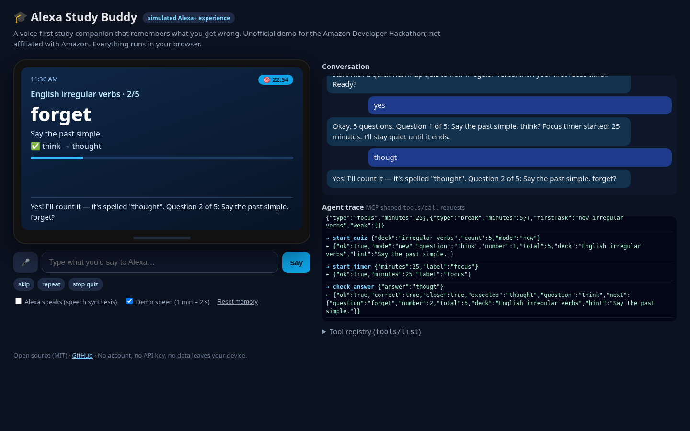
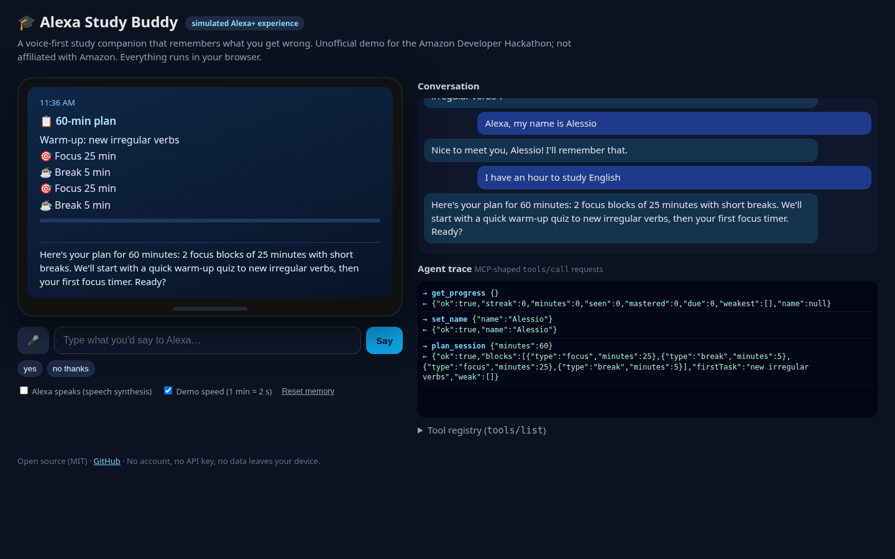
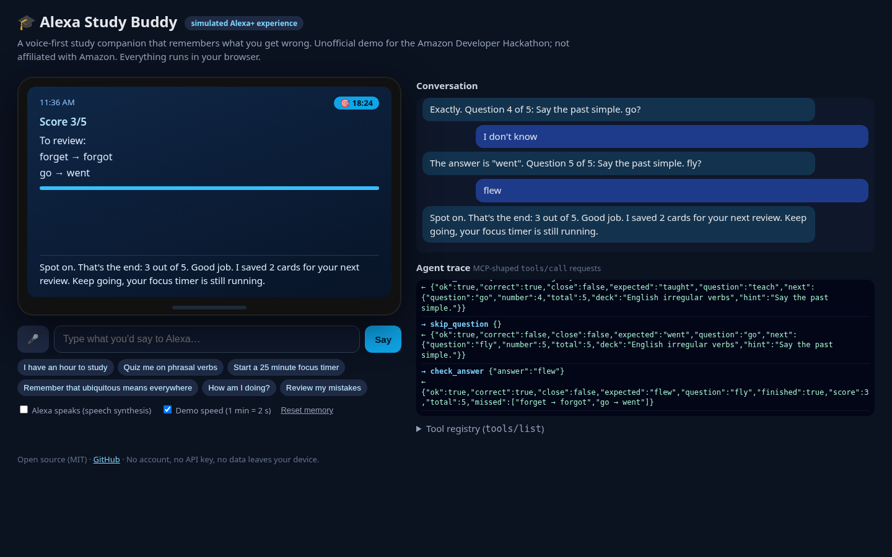
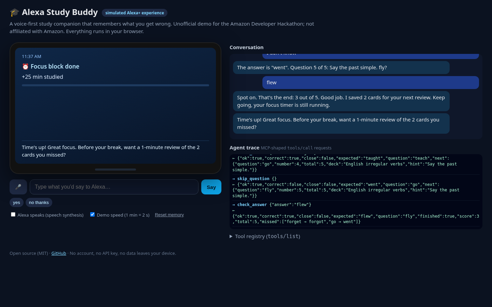
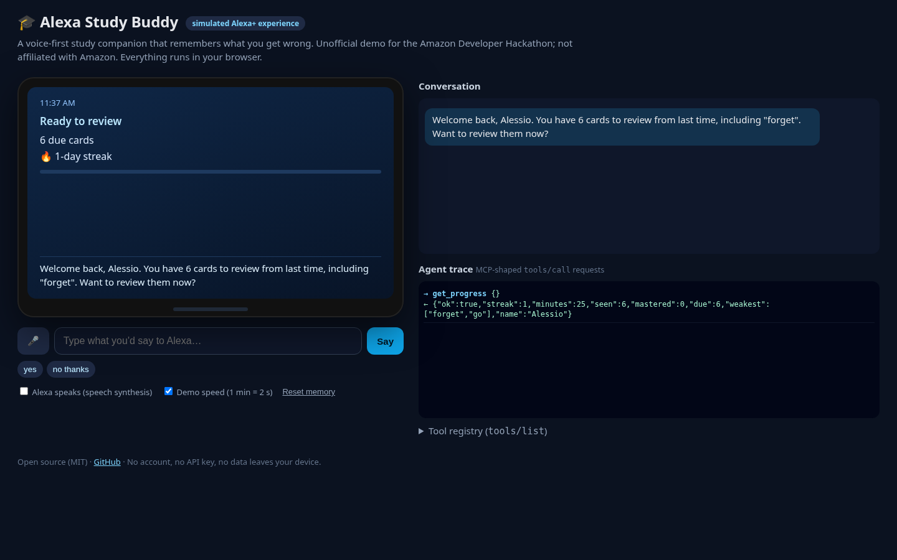

# 🎓 Alexa Study Buddy: a simulated Alexa+ experience

A voice-first study companion that **remembers what you get wrong**. Tell it how much time you have, and it plans a Pomodoro session, quizzes you out loud with spaced repetition, runs your focus timers, speaks up when a timer ends, and opens your next session with the cards you missed.

Built for the **Build, Ship, Shape: Amazon Developer Hackathon**, Alexa+ track, *"New to MCP? Build a simulated Alexa+ experience in a web app"* path. Unofficial project, not affiliated with or endorsed by Amazon.

**▶ Live demo:** https://asosa933.github.io/alexa-study-buddy/  (add `?fast` for demo speed: 1 timer minute = 2 seconds)



## What it does

| You say | What the agent does (tool calls) |
|---|---|
| "I have an hour to study English" | `plan_session` → 2 × 25-min focus blocks + breaks, warm-up chosen from memory (due/weak cards first) |
| "yes" | `start_quiz` **and** `start_timer` (one confirmation, two actions) |
| "brougt" / "goed" / "I don't know" | `check_answer` / `skip_question`: forgives one-letter slips, saves misses for review (Leitner boxes) |
| *(timer ends)* | Alexa speaks **first**: "Time's up! Want a 1-minute review of the 2 cards you missed?" |
| "Remember that ubiquitous means everywhere then quiz me on my words" | `add_card` → `start_quiz` (multi-intent in one sentence) |
| "How am I doing?" | `get_progress`: streak, focus minutes, weakest cards, due cards |
| *(next day)* | Proactive greeting: "Welcome back, Alessio. You have 3 cards to review…" |

Decks: English irregular verbs, phrasal verbs, European capitals, JavaScript basics, plus your own "my words" deck.

## How it works

```
speech (Web Speech API) or text
  → agent.js: NLU (multi-intent clauses + dialog state: quiz in progress, pending offer)
  → plan of tool calls → tools.js (MCP-shaped registry: name, description, JSON-Schema inputSchema)
  → memory.js (spaced repetition, streak, minutes; localStorage)
  → Alexa-style speech (speechSynthesis) + Echo Show-style visual card
```

- **12 tools** with MCP `tools/list`-shaped definitions; every call is logged as a JSON-RPC `tools/call` request/result in the on-screen **Agent trace**, so you can see exactly what the agent did. The registry is designed so it can be moved behind a real MCP server (Streamable HTTP) for Alexa+ later.
- **Proactive, multi-turn:** the agent keeps state across turns (current question, pending offers like "want a timer?") and starts conversations itself (timer done, due reviews on wake).
- **Free and private:** no backend, no account, no API key. Speech recognition/synthesis come from the browser. Memory stays in `localStorage`.

## Run it

No build step. Serve the folder with any static server:

```bash
git clone https://github.com/asosa933/alexa-study-buddy && cd alexa-study-buddy
python3 -m http.server 8000   # then open http://localhost:8000/?fast
npm test                      # 8 unit tests of the agent, tools and memory (Node 18+)
```

Use Chrome or Edge for voice input (🎤). Typing works everywhere.

## Screenshots

| Plan | Score | Timer done (proactive) | Welcome back |
|---|---|---|---|
|  |  |  |  |

## Built with

HTML/CSS/JavaScript (ES modules), Web Speech API, Puppeteer (end-to-end test + demo recording), an AI coding assistant as my agentic tool.

## License

MIT
